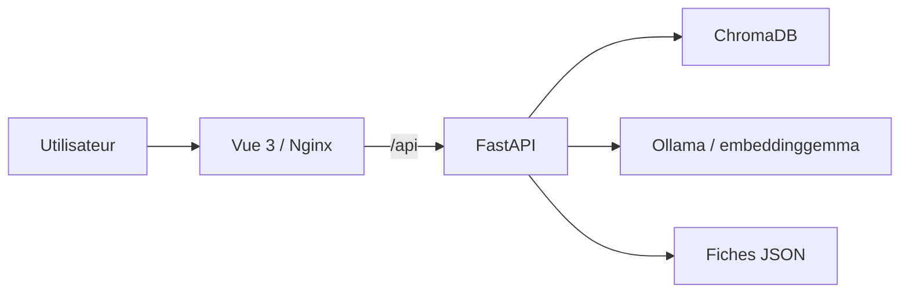

# 3D Gallery Search

3D Gallery Search est une galerie de modèles 3D où l'on peut chercher en langage naturel.
L'application associe une interface Vue 3, une API FastAPI, ChromaDB et Ollama pour vectoriser
les fiches du catalogue et les requêtes.

## Démarrer rapidement

Depuis la racine du dépôt, avec Docker Desktop et Docker Compose installés :

```powershell
docker compose up --build
```

Ouvrez ensuite <http://localhost:8080>. Au premier démarrage, Docker télécharge Ollama et le
modèle d'embedding `embeddinggemma`; cette étape peut prendre plusieurs minutes.

Consultez [Installation & déploiement](technique/deploiement.md) pour les commandes, les volumes
persistants et le dépannage.

## Fonctionnalités disponibles

- Chercher des fiches de modèles et consulter leur pertinence.
- Ouvrir une fiche détaillée avec la description générale, les descriptions par vue et les
  divergences signalées.
- Afficher un aperçu 3D sur la page détail lorsqu'un fichier source est disponible.
- Importer un fichier `.obj`, `.gltf` ou `.stl` (50 Mo maximum). L'import sauvegarde le fichier,
  mais ne lance pas encore les Lots A et B : il n'est pas recherchable avant la création et
  l'indexation de sa fiche.

Le jeu de démonstration comprend cinq fiches : chaise, maison, voiture, arbre et épée. Le
conteneur backend leur attribue des embeddings Ollama au premier démarrage.

## Architecture



Les services et leurs échanges sont décrits dans [Architecture](technique/architecture.md).

## Parcours conseillés

1. Suivez le [guide d'utilisation](utilisateur/guide.md) pour effectuer une recherche et ouvrir
   une fiche.
2. Consultez la [FAQ](utilisateur/faq.md) en cas de problème de démarrage ou d'aperçu.
3. La [référence Recherche (Lot C)](reference/recherche.md) décrit les routes de l'API.
