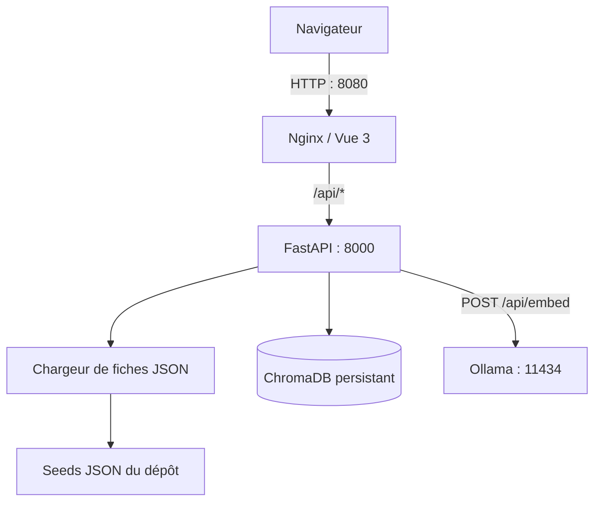

# Architecture

## Vue d'ensemble

Le dépôt est organisé en trois parties :

- **Frontend** — application Vue 3 et TypeScript. En production, Nginx sert les fichiers statiques
  et transmet les requêtes `/api` au backend.
- **Backend** — API FastAPI. Elle charge et valide les fiches Pydantic, interroge ChromaDB et
  utilise le client HTTP Ollama pour vectoriser les requêtes.
- **Ollama** — service local exécuté dans Docker Compose. Le modèle `embeddinggemma` fournit les
  vecteurs utilisés par la recherche.

Le port Ollama publié par Compose est limité à `127.0.0.1` sur l'hôte. Le backend utilise le nom
de service Docker `ollama` pour communiquer avec lui.

## Démarrage et données de démonstration

Au démarrage, `backend/scripts/preparer_donnees_demo.py` copie les cinq fiches de
`backend/seed/fiches/` vers le dossier de données du backend. Le script génère les embeddings des
descriptions avec Ollama et valide chaque fiche avant son écriture atomique. Le backend indexe
ensuite les fiches validées dans ChromaDB.

Les fiches et l'index sont conservés dans le volume Docker `backend-data`; les modèles Ollama sont
conservés dans `ollama-models`. Un `docker compose down` n'efface pas ces volumes.

## Recherche et fiche détaillée

1. Le frontend envoie la requête à `GET /api/recherche`.
2. Le backend vectorise le texte avec Ollama, puis demande à ChromaDB les résultats classés.
3. Les identifiants retournés sont résolus en fiches JSON.
4. Le lien d'un résultat ouvre `/modeles/:id`. La page appelle `GET /api/modeles/{id}` et affiche
   les détails de la fiche; si un fichier 3D est disponible, elle le récupère avec
   `GET /api/modeles/{id}/fichier`.

Les fiches de démonstration ne contiennent pas de fichier 3D : leur page détail présente les
descriptions par vue et les divergences, mais pas de modèle interactif.

## Limites du flux d'import

La page d'ajout accepte les formats OBJ, GLTF et STL et sauvegarde le fichier. Le traitement
multi-vues (Lot A), la génération d'une fiche sémantique (Lot B) et l'indexation automatique de
ce nouveau fichier ne sont pas encore déclenchés par l'import.

## Points d'entrée

- `backend/main.py` — assemblage de l'API, des services et de ChromaDB.
- `backend/src/recherche/router.py` — routes HTTP du Lot C.
- `backend/src/recherche/service_recherche.py` — orchestration recherche/embeddings.
- `backend/src/recherche/chargeur_fiches.py` — chargement et validation des fiches.
- `frontend/src/services/galleryApi.ts` — appels API du frontend.
- `docker-compose.yml` — services Ollama, backend et frontend.
